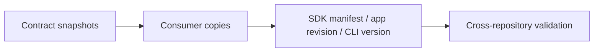

# Contracts

Machine-readable contract snapshots live in repository-root `contracts/`. Check the producer revision and consumer pin before using a snapshot for a release; the snapshots can lag current producer source.

The CLI artifact snapshot records version `1.0.19` from commit `7b14ada97710`. The OpenAPI snapshot comes from server commit `22096e8e237a`; neither snapshot establishes what is deployed. Use the producer contract for the exact revision being integrated.

The Core snapshots match source revision `3bce730191d087c56684ee30743319f4a64918a4`, associated with SDK `1.0.2-dev.16`. The Windows x64 manifest SHA-256 was verified against the CLI lock; other target manifests were not verified. The server still pins SDK `1.0.2-dev.4`, so its capabilities must be checked separately. The four model-input streaming functions require the matching SDK capability and build feature.

| Contract | Snapshot | Consumer |
|---|---|---|
| Core distribution / operations | `core-api.json` | Core and safe SDK |
| C ABI / JSON DTOs | `core-abi/` | Core header and safe SDK adapters |
| Server HTTP | `openapi.yaml` | Server and API clients |
| CLI packages / sidecars | `cli-artifact-manifest.json` | CLI packaging |
| Desktop compatibility | `client-compatibility-matrix.json` | Client staging |



```sh
node contracts/validate.mjs
```

| Rule | Requirement |
|---|---|
| ABI | Business C interface; no public vector/mathematics API |
| Resource boundary | Host supplies model/tokenizer and opaque index bytes; Core does not accept storage paths or open files/databases |
| SDK | Pin target, compiler, manifest hash and runtime files |
| Server | Pin the infrastructure app crate, not the CLI executable |
| Sidecar | Include its runtime libraries and notices |
| Breaking change | Coordinate producer and consumer pins before release |

Translation does not change operation names, status codes, JSON fields, binary names or target mapping. Contract validity does not prove a release is available.

[Development](development.md)
