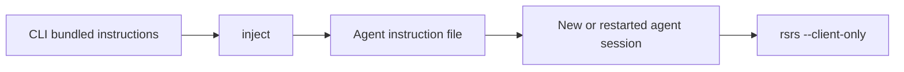

# Agent integration

`rsrs inject` installs the CLI's bundled instructions into supported agent configuration files. The authoritative instruction text is maintained in the CLI repository, not copied into this documentation site.

```sh
rsrs inject --targets
rsrs inject --id codex
rsrs inject --remove --id codex
```

Run `inject --targets` to inspect resolved paths and detection state on the current machine. Preset paths are conventions; an agent with custom configuration may need its own instruction reference.

| Integration mode | Behavior |
| --- | --- |
| Managed block | Replaces only the block between Respire markers |
| Reference | Writes an instruction file and updates the supported configuration reference |
| Full-file target | Replaces the target contents with the instruction text |



| Check | Action |
| --- | --- |
| Target missing | Inspect `inject --targets` and the agent's real configuration path |
| Multiple configuration files | Check which file and instruction list the agent loads |
| Existing long-running session | Restart or open a new session after changing instructions |
| Instruction source changed | Rebuild or update the CLI, then run `inject` again |
| Runtime connection failure | Inspect the local runtime and authentication; do not silently switch execution modes |

Managed blocks use `<!-- respire:begin -->` and `<!-- respire:end -->`. Preserve unrelated instructions outside the block. The DSH full-file target is `~/.dsh/AGENTS.md`: injection replaces its existing contents and removes a symlink at that path before writing. Inspect and back up the target before installation.

## First-run inject from a portable package {#first-run-inject}

[respire-general](plugins/general.md) has no install script and no host hooks. Its MCP bridge performs the first inject check when the host starts the MCP server:

```sh
node scripts/setup-inject.mjs --target auto
node scripts/setup-inject.mjs --target auto --check
```

The helper reads `rsrs inject --targets --json`, then injects only when the target is `absent` or `stale`; a `current` target is skipped, so repeated starts do not rewrite the file. A successful inject is recorded in `inject-state.json` under the plugin data directory. Set `auto_inject: false` to disable the MCP-start check, or `inject_target` to pin a target. mcode has no `rsrs inject` target, so the portable package skips it; use the [MiniMax Code hooks package](plugins/minimax-code.md) there.

See [CLI](cli.md), [CLI JSON](cli-api.md), [plugins](plugin-dev.md) and the ready-made [AI tool plugins](plugins/index.md).
