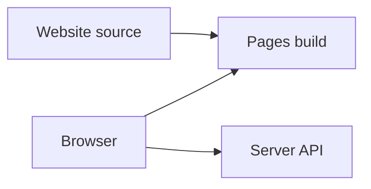

# Website

The website presents the product; it is not the local memory client.

| Assigned domain | Purpose |
|---|---|
| `https://rsrs.rs` | Main product website |
| `https://dash.rsrs.rs` | User dashboard |
| `https://admin.rsrs.rs` | Administration dashboard |
| `https://api.rsrs.rs` | API and synchronization |

| Area | Responsibility |
|---|---|
| Product pages | Website repository; English and Chinese content |
| Account pages | Web frontend integrated with the server |
| Authentication/sync | Server API |
| Local memory operations | CLI / desktop client |

The site repository describes a Cloudflare Pages deployment for the website and dashboards. Its rollout plan retains existing containers and traffic until a separate cutover. Site branch updates can trigger Pages deployments; API deployment remains separate. Check the actual deployment configuration and traffic before assuming a change is live.

Keep branch previews disabled until an isolated test API, database and mail fixture are ready. Configure `VITE_API_BASE_URL` to that API's exact HTTPS origin and allow each exact preview origin in `RSRS_CORS_ALLOWED_ORIGINS`. Use synthetic accounts without credentials in the public build. See the [Pages deployment contract](https://github.com/risense-ai/respire-site/blob/main/console/CLOUDFLARE-PAGES.md) for the full preview and rollout conditions.

[Server deployment](../server-deployment.md) · [Dashboard](web.md)
