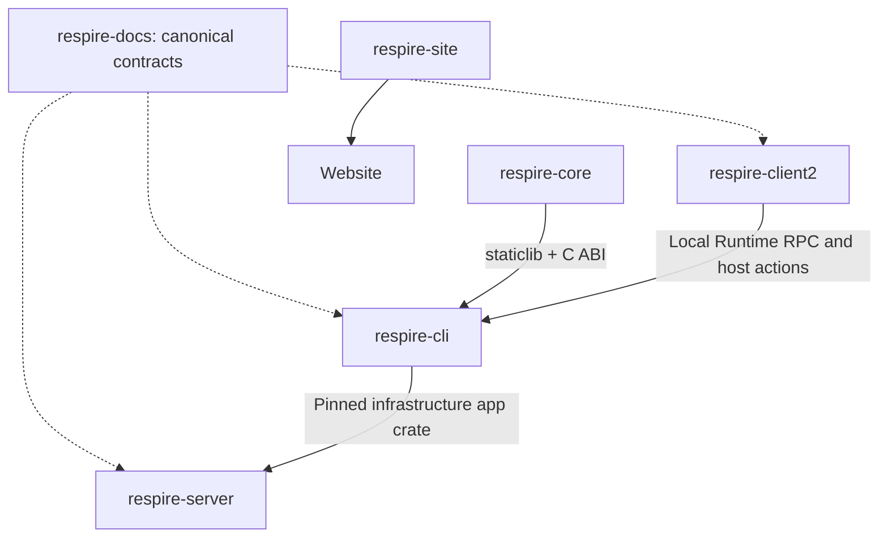

# Repositories

| Repository | Purpose |
|---|---|
| [respire-cli](https://github.com/risense-ai/respire-cli) | CLI plus protocol, crypto, storage, app and safe SDK crates |
| [respire-server](https://github.com/risense-ai/respire-server) | Authentication, encrypted storage, HTTP API and deployment |
| [respire-client2](https://github.com/risense-ai/respire-client2) | Go/Wails desktop client, embedded UI and local Runtime management |
| [respire-docs](https://github.com/risense-ai/respire-docs) | Documentation and canonical contracts |
| [respire-site](https://github.com/risense-ai/respire-site) | Marketing website source |
| [respire-releases](https://github.com/risense-ai/respire-releases) | Release information and matching binary assets |
| [respire-core](https://github.com/risense-ai/respire-core) | Model execution and memory operations; binary SDK |
| [respire-memtool](https://github.com/risense-ai/respire-memtool) | Tauri desktop quick-capture companion; see the [memTools guide](/guides/memtools) |

## AI tool plugins

Eleven host plugins connect Respire to AI tools. The portable [respire-general](https://github.com/risense-ai/respire-general) package covers Agent Plugins 1.0 clients that have no dedicated adapter. See the [plugin guides](/plugins/) for installation and usage.

| Repository | Host / use |
|---|---|
| [respire-zcode](https://github.com/risense-ai/respire-zcode) | ZCode |
| [respire-kimi](https://github.com/risense-ai/respire-kimi) | Kimi Code |
| [respire-dimcode](https://github.com/risense-ai/respire-dimcode) | Dim |
| [respire-qoder](https://github.com/risense-ai/respire-qoder) | Qoder |
| [respire-workbuddy](https://github.com/risense-ai/respire-workbuddy) | WorkBuddy |
| [respire-hermes](https://github.com/risense-ai/respire-hermes) | Hermes Agent |
| [respire-codex](https://github.com/risense-ai/respire-codex) | Codex |
| [respire-pi](https://github.com/risense-ai/respire-pi) | Pi |
| [respire-dsh](https://github.com/risense-ai/respire-dsh) | DSH |
| [respire-magpie](https://github.com/risense-ai/respire-magpie) | Magpie |
| [respire-minimax-code](https://github.com/risense-ai/respire-minimax-code) | MiniMax Code 0.4+ (`SessionStart` / `UserPromptSubmit` / `Stop` hooks) |
| [respire-general](https://github.com/risense-ai/respire-general) | Any Agent Plugins 1.0 client (skill + MCP; no hooks) |

CLI/server do not check out Core source or use a Core submodule. The CLI pins an SDK manifest; the server pins the infrastructure app crate revision and uses the same SDK boundary.

| Change | Coordinate |
|---|---|
| Core ABI / SDK | Canonical contract, validated SDK manifest and consumer lock |
| Infrastructure app | CLI source revision and server dependency |
| CLI output | CLI contract and desktop consumers |
| Desktop Runtime | CLI release metadata, platform target and runtime resources |
