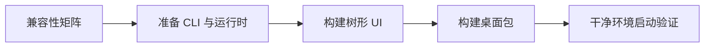

# 客户端集成 {#client-integration}

| 职责 | 归属 |
|---|---|
| UI 和 Tauri 外壳 | 客户端仓库 |
| 记忆操作和本地身份 | CLI |
| 协议/输出契约 | 规范契约和 CLI 适配器 |
| 检索/模型执行 | 通过 SDK 调用 Core |
| 加密远程记录 | 服务端 |

构建前：

1. 检查 `contracts/client-compatibility-matrix.json` 和 CLI 产物目标。
2. 获取兼容 sidecar，准备运行时清单和资源。
3. 运行现有前端检查。
4. 使用平台依赖构建原生桌面包。
5. 在干净环境中验证打包后的应用。

| 本地记录 | 写入方 |
|---|---|
| `session.json` | CLI 注册/登录 |
| `client.json` | 与 CLI 共享的客户端偏好 |
| 本地 SQLite | CLI/应用层 |
| 注入块 | CLI 托管目标实现 |

不要在 UI 中重复实现密钥管理或推理。CLI JSON 或同步/认证行为发生变化时，必须同时检查 CLI 和客户端使用方。

[客户端](client.md) · [契约](contracts.md) · [开发](development.md)
