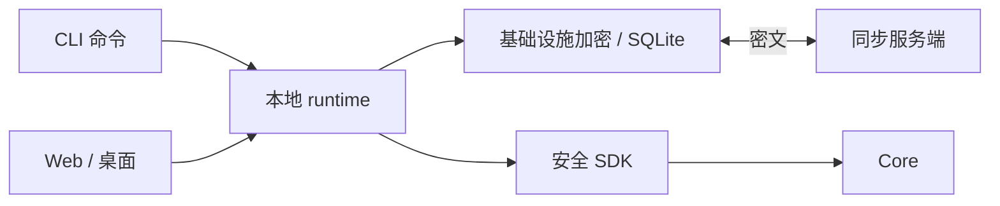
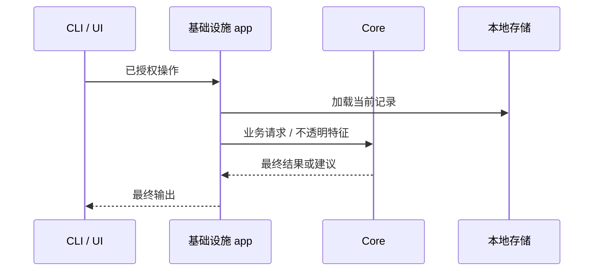

# Runtime 流程 {#runtime-flow}

| 路径 | 流程 |
|---|---|
| 写入 | 验证输入 → 获取 Core 建议/特征 → 授权更改 → 加密并持久化 |
| 读取 | 加载已授权本地快照 → Core 选择最终结果/上下文 → 最终输出 |
| 树结构变更 | 一起更新加密的父节点元数据与本地索引 |
| 同步 | 拉取修订/tombstone → 应用冲突规则 → 推送脏记录 → 保存 cursor |
| 注入 | CLI 模板 → 目标 AI 工具中的受管理块 |

Runtime 持有数据目录锁。可用时，普通命令使用 runtime。直接维护前须先停止 runtime；支持的选项以已安装 CLI 的帮助为准。

派生行必须匹配当前来源密文、模型与索引代次。记录更新或模型变更会使旧特征失效；应重建，而非将不兼容产物视为有效。

[开发](development.md) · [契约](contracts.md)
