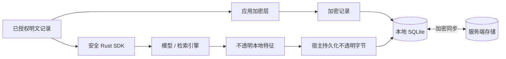

# 架构 {#architecture}

本地记忆库是工作中的权威数据源。服务端存储加密记录；本地检索不需要向服务端发请求。

常驻 runtime 加载 ONNX 并在同一进程内推理。一个共享模型会话将推理调用排队。宿主读取模型/tokenizer 字节，并向 Core 提供显式设置。模型文件与 CPU/GPU/NPU 选择是宿主的全局资源。切换账户会选择不同记忆库及索引，但保留这些全局设置。命令线程和后台线程处理模型任务时，HTTP 健康与进度处理器仍可用。

客户端在初次 health、RPC 与 stop 请求中保留已有 runtime token。新的 loopback runtime 忽略该请求头；已认证的旧 runtime 仍要求它。移除服务端认证不等于移除客户端升级兼容性。宿主接管先验证 runtime、使其正常停止，再等待进程、监听器及记忆库锁释放后启动继任者。受限客户端不能执行生命周期操作。

自 1.0.6 起，每个已发布的稳定 CLI 版本均列入发布验证矩阵的升级来源。版本清单动态读取，因此新的稳定版本会成为后续版本的升级来源。缺少产物或检查失败会阻止发布。由于当前发布注册表中没有正式 1.0.6 产物，额外使用一个 1.0.6 DEV 产物作为历史基线。

| 信任边界 | 负责的内容 |
|---|---|
| 基础设施客户端层 | 账户密钥、已授权明文、加密、同步、文件、数据库、模型加载与 HTTP |
| Core | 内存推理、不透明数据结构、特征解释、检索、排序、上下文策略与请求规划 |
| 服务端 | 身份认证与加密记录；不持有客户端解密密钥 |
| UI | 通过 CLI 操作取得最终结果并执行已授权写入 |

本地元数据及派生特征不属于同步 wire DTO。特征产物是可重建的本地数据，并非加密秘密。运行时仍可观察最终分数与已授权明文。

Core 不解析路径、不选择文件名、不读取环境变量，也不开启文件或数据库。宿主传递字节及显式设置，而非存储路径。私有索引编码与算法留在 Core；基础设施代码只存储与来源密文及索引代次绑定的不透明字节。

| 操作 | 结果 |
|---|---|
| Remember / update / forget | 先本地写入，再允许 runtime 后台同步 |
| Recall | Core 返回本地最终结果 |
| 更改密码 | 更新密钥封装，而非重新加密全部记忆 |
| 删除 | 同步 tombstone，保持跨设备收敛 |

参见[数据模型](data-model.md)、[Runtime 流程](architecture-internals.md)及[同步与密钥](sync-and-keys.md)。
