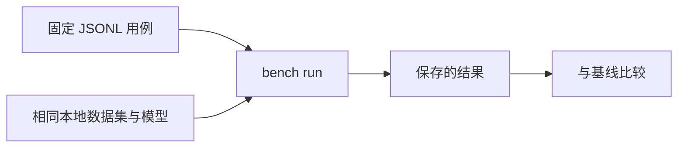

# 检索基准测试 {#retrieval-benchmarks}

`rsrs bench` 在固定的本地评估集上比较可观察的检索结果。它不描述 Core 的排序实现。



```sh
rsrs bench mine --out retrieval.jsonl
rsrs bench run retrieval.jsonl --save baseline.json
rsrs bench run retrieval.jsonl --baseline baseline.json
```

## 评估格式 {#evaluation-format}

```json
{"query":"database backup","expect":["12345678"],"project":null,"note":"optional"}
```

| 字段 | 含义 |
| --- | --- |
| `query` | 查询文本 |
| `expect` | 预期记录标识符或前缀；任一结果匹配即可 |
| 空 `expect` | 负例：预期没有结果 |
| `project` | 可选项目范围 |
| `note` | 可选评估备注 |

跳过空行和以 `#` 开头的行。记录被删除或合并时，应更新预期标识符。

| 指标 | 含义 |
| --- | --- |
| Hit at 1 / 3 / top-k | 正例中在指定截断位置内命中的比例 |
| MRR | 平均倒数排名；未命中贡献零 |
| 正例结果为空 | 未返回结果的正例 |
| 负例噪声 | 返回了结果的负例 |

## 可复现性 {#reproducibility}

| 保持不变 | 比较时记录 |
| --- | --- |
| 数据 | 数据集身份和大小 |
| 模型 | 模型身份与版本 |
| 软件 | CLI 和二进制 SDK 版本 |
| 评估 | 相同用例、范围和 top-k |
| 环境 | 相关配置和硬件 |

基准测试路径不会写查询日志，也不会增加召回热度。普通 `recall` 具有不同副作用。应比较等价运行；单独保存的分数不能证明另一台机器或平台上的性能。

当前输出和控制选项见 `bench --help` 和 `bench run --help`。公开基准报告应省略私密记忆文本和敏感标识符。
