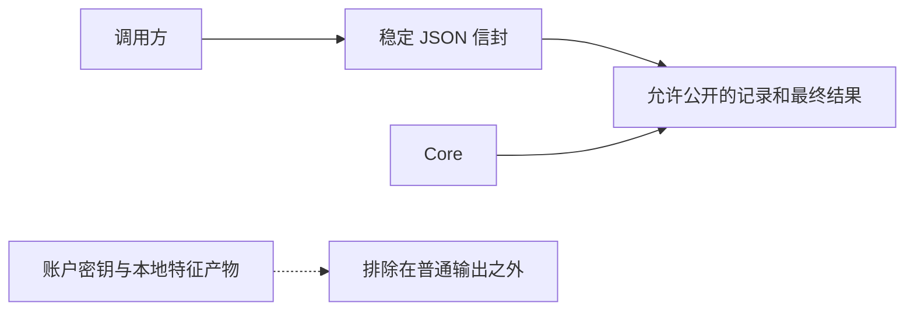

# CLI JSON API {#cli-json-api}

将 Respire 与脚本、代理或应用集成时，请使用 `--json`。解析 JSON 信封，不要匹配面向人的消息文本。

```json
{
  "command": "recall",
  "status": "ok",
  "summary": {},
  "items": [],
  "actions": [],
  "errors": [],
  "details": null,
  "related": []
}
```

| 字段 | 用途 |
| --- | --- |
| `command` | 已执行的命令 |
| `status` | `ok`、`warn`、`fail`、`skip` 或 `pending` |
| `summary` | 计数、标识符与命令级结果 |
| `items` | 紧凑结果行 |
| `actions` | 后续操作 |
| `errors` | 已报告的失败 |
| `details` | 命令允许公开的特定数据 |
| `related` | 有界召回关联：ID、标题、源 ID 和关系；其他命令返回空数组 |

| 退出码 | 含义 |
| --- | --- |
| `0` | 已完成，包括正常的空结果 |
| `2` | 警告或等待决策 |
| `1` | 参数、会话、存储、传输或执行失败 |

非零退出时也要读取结果信封：等待候选项决策与写入失败并不相同。将标准错误与标准输出分开处理。

## 结果结构 {#result-shapes}

| 命令族 | 典型数据 |
| --- | --- |
| `status`、`doctor`、`audit` | 摘要和诊断行 |
| `recall` | 标识符、标题与最终结果分数；允许公开的记录详情 |
| `list`、`show`、`chain`、`tree` | 记录或关系数据 |
| `remember`、`attach` | 操作和标识符；不包含秘密载荷 |
| `sync`、`sync-*` | 计数、冲突和保留版本 |
| `config`、`agent-config` | 不含秘密的配置 |
| `import`、`export`、`backup` | 路径和计数 |

规范机器契约位于仓库的 `contracts/` 目录。归属与兼容规则见[契约](contracts.md)。

召回在 `details` 中保留主要命中的顺序和分数。独立的 `related` 数组只包含标题关联；`summary.related` 统计关联数量。召回详情行通过 `superseded_by` 表示有效替代记录。对于旧运行时缺失的 `related` 字段，客户端应将其视为空数组。写入与升级规则见[记忆关联](associations.md)。

## 数据边界 {#data-boundaries}



普通输出不包含密文、nonce、封装密钥、认证令牌和本地特征产物。专门揭示或导出秘密的命令需要各自的选项；应将其输出视为敏感数据。

SDK 内部业务请求与此 CLI API 相互独立。应用应使用命令结果，不应构造内部向量或排序请求。
