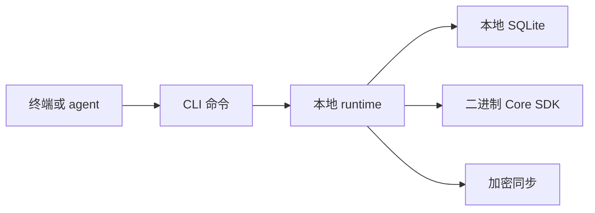

# CLI {#cli}

`rsrs` 是 Respire 唯一的 CLI 命令，负责本地记忆、加密、同步和集成。检索与记忆策略通过二进制 SDK 在 Core 中执行；不提供 `respire` 或 `rs` 命令别名。

```sh
rsrs help
rsrs --help
rsrs recall --help
rsrs status --json
```

可用选项以已安装可执行文件的帮助为准。自动化接口见 [CLI JSON](cli-api.md)。

## 日常命令 {#everyday-commands}

| 任务 | 命令 | 效果 |
| --- | --- | --- |
| 存储 | `remember "content" --title "title"` | 写入前检查候选 |
| 查找 | `recall "query" --titles --json` | 返回匹配的标题与标识符 |
| 读取 | `show <id> --json` | 读取选中的记录 |
| 浏览 | `list`、`tree`、`chain <id>` | 列出记录及关系 |
| 编辑 | `update <id> --content "content"` | 创建新的本地内容修订 |
| 删除 | `forget <id>` | 写入 tombstone |
| 恢复 | `restore <id>` | 恢复仍保留的记录 |
| 检查 | `doctor`、`audit` | 报告本地问题 |

决定合并、挂载或创建记录前，先读取候选。支持短标识符的命令要求前缀没有歧义。

## 管理 {#management}

| 范围 | 命令 |
| --- | --- |
| 关系 | `attach`、`promote`、`demote`、`resort` |
| 维护 | `candidates`、`defrag`、`tree-cure`、`tree-deepen`、`tree-float`、`repack`、`reembed` |
| 数据传输 | `import`、`export`、`backup`、`share`、`share-import` |
| 账户 | `keygen`、`register`、`login`、`logout`、`account`、`session` |
| 同步 | `sync`、`sync-conflicts`、`sync-resolve`、`sync-history`、`sync-restore`、`sync-reset` |
| 集成 | `inject`、`plugin`、`mcp`、`web` |
| 配置 | `config`、`agent-config`、`model`、`status` |

更改数据前请阅读各命令的帮助。部分维护命令先生成计划，再要求显式执行选项。导出与分享文件包含明文；数据库备份不能替代密钥备份。

## Runtime 与输出 {#runtime-and-output}



| 接口 | 契约 |
| --- | --- |
| 标准输出 | 最终结果；使用 `--json` 时为单个 JSON 对象 |
| 标准错误 | 进度、诊断与警告 |
| `--client-only` | 连接已有且已认证的本地 runtime |
| `--direct` | 直接在本地执行；须遵循已安装命令的锁要求 |

## 配置兼容性 {#configuration-compatibility}

产品名为 Respire，所属组织为 risense-ai。唯一命令、原生二进制及 sidecar 前缀均为 `rsrs`。仓库/crate 名仍使用 `respire-*` 与 `respire_*`；Core ABI 仍为 `rs_core_*`。默认数据根目录为 `~/.rsrs`，runtime 端口为 `15169`。启动不会迁移旧本地账户。Doctor 与 TUI 会标识尚未迁移的来源；只有用户显式选择来源和账户后才迁移，并保留原目录。`rsrs web` 打开托管 dashboard `https://dash.rsrs.rs`。已有 `ONEMEMORY_*` 变量仍是宿主侧兼容输入。SDK 控制使用 `RSRS_CORE_SDK_DIR` 与 `RSRS_CORE_TEST_MODE`；Core 本身不读取环境变量。没有新增 `RS_*` 环境变量命名空间。

配置的默认 API 为 `https://api.rsrs.rs`；`--addr` 可选择本地服务。配置了域名不等于该域名已实际部署。

| 变量 | 用途 |
| --- | --- |
| `RSRS_DATA_DIR` | 选择独立的本地数据目录 |
| `RSRS_NO_AUTOSYNC=1` | 禁用自动同步 |
| `RSRS_ADDR`、`RSRS_TOKEN` | 远程连接配置 |
| `RSRS_JSON=1` | 请求 JSON 输出 |
| `RSRS_MODEL_DIR`、`RSRS_M3_DIR` | 显式模型目录 |
| `RSRS_RERANKER_DIR` | 显式 reranker 目录 |

参见[同步与密钥](sync-and-keys.md)、[agent 集成](injection.md)与[基准测试](benchmark.md)。
