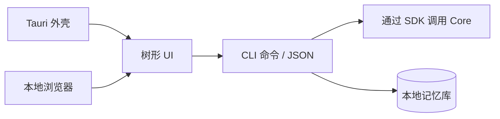

# 客户端 {#client}

桌面客户端使用 Tauri，与本地 Web 共用树形 UI。记忆操作通过 CLI 完成；客户端不包含记忆引擎。

| 视图 | 行为 |
|---|---|
| 搜索 | 本地检索和分类过滤 |
| 树 | 展开根节点/子树并查看关系 |
| 详情 | 条目内容、父子关系及授权编辑 |
| 创建 | 决策前检查重复项/父节点建议 |
| 维护 | 分析结构、重建索引和导出/导入 |
| 账户 | 登录、恢复、自动同步和手动同步 |
| 注入 | 检测目标工具并更新托管块 |

本地记忆库和密钥处理与 CLI 共享。服务端注销不会删除本地记录。恢复密钥导出属于敏感操作，JSON 条目导出为明文。

## 打包边界 {#packaging-boundary}

| 项目 | 要求 |
|---|---|
| CLI sidecar | 产物契约规定的兼容版本 |
| 运行时文件 | `core-runtime.json` 及其已验证的运行时资源 |
| 模型 | 匹配的模型资源和许可证 |
| 桌面资源 | UI、平台运行时和安装器配置 |
| 兼容性 | 规范客户端/CLI 目标映射 |

刚克隆的客户端源码不提供兼容 CLI 二进制文件。准备 sidecar 前先获取兼容发布。Windows 包必须在 sidecar 旁包含所需运行时库；见 [Windows 打包](windows-packaging.md)。

[客户端集成](CLIENT-GUIDE.md) · [本地 Web](product/web.md)
