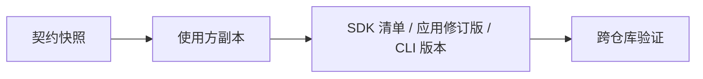

# 契约 {#contracts}

机器可读契约快照位于仓库根目录的 `contracts/`。发布前应检查生产方修订版和使用方固定版本；快照可能落后于生产方当前源码。

CLI 产物快照来自提交 `7b14ada97710`，记录版本为 `1.0.19`。OpenAPI 快照来自服务端提交 `22096e8e237a`；两者均不能证明线上部署状态。集成时请使用对应修订版的生产方契约。

Core 快照对应源码修订版 `3bce730191d087c56684ee30743319f4a64918a4`，关联 SDK `1.0.2-dev.16`。Windows x64 清单的 SHA-256 已与 CLI 锁文件核对；其他目标的清单尚未核验。服务端仍固定 SDK `1.0.2-dev.4`，其能力需要单独检查。四个模型输入流式函数需要匹配的 SDK 能力和构建特性。

| 契约 | 快照 | 使用方 |
|---|---|---|
| Core 分发 / 操作 | `core-api.json` | Core 和安全 SDK |
| C ABI / JSON DTO | `core-abi/` | Core 头文件和安全 SDK 适配器 |
| 服务端 HTTP | `openapi.yaml` | 服务端和 API 客户端 |
| CLI 包 / sidecar | `cli-artifact-manifest.json` | CLI 打包 |
| 桌面兼容性 | `client-compatibility-matrix.json` | 客户端准备流程 |



```sh
node contracts/validate.mjs
```

| 规则 | 要求 |
|---|---|
| ABI | 业务 C 接口；不公开向量或数学 API |
| 资源边界 | 宿主提供模型/tokenizer 和不透明索引字节；Core 不接受存储路径，也不打开文件或数据库 |
| SDK | 固定目标、编译器、清单哈希和运行时文件 |
| 服务端 | 固定基础设施 app crate，而非 CLI 可执行文件 |
| Sidecar | 包含其运行时库和声明 |
| 破坏性变更 | 发布前协调生产方和使用方的固定版本 |

翻译不改变操作名称、状态码、JSON 字段、二进制名称或目标映射。契约有效并不证明发布已可用。

[开发](development.md)
