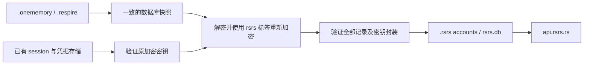
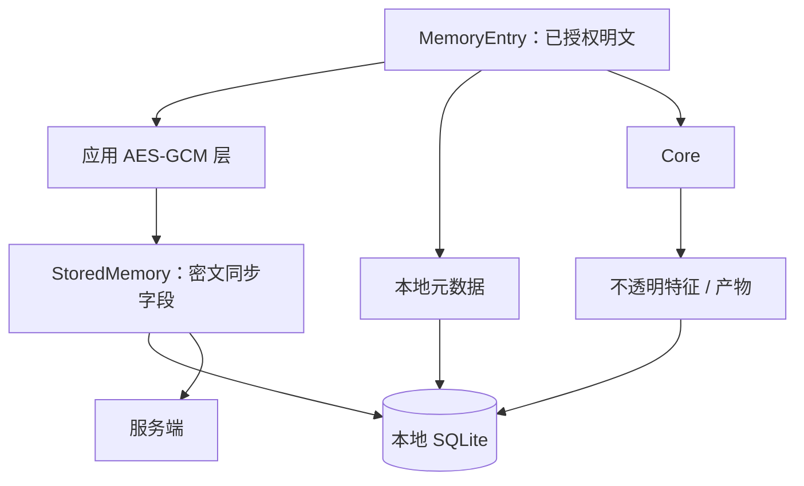

# 数据模型 {#data-model}

Respire 使用 `~/.rsrs`。启动保留当前账户、API 偏好、数据及密钥，不复制旧账户。显式迁移发现 `~/.onememory`、`~/.respire` 与旧格式 `.rsrs` profiles 中受支持的账户；由用户选择来源与目标。原目录保持完整。当前选项使用 `RSRS_*`；`ONEMEMORY_*` 与旧 `RESPIRE_*` 选项是只读兼容别名。当前选项存在时优先使用它。

| 本地项目 | 用途 |
|---|---|
| `~/.rsrs/rsrs.db` | 新格式加密记录、本地元数据与特征索引；已有 `onememory.db` 在显式迁移前仍可读 |
| `session.json` | 身份、地址、token 与密钥材料 |
| `client.json` | 客户端偏好、服务端地址与自动同步设置 |
| `lock.db` | 本地 runtime 独占锁 |
| `~/.rsrs/models/` | 默认 tokenizer/模型资源 |
| `~/.rsrs/inference.json` | 推理引擎设置 |

`RSRS_DATA_DIR` 选择数据根目录。不要提交 session 文件、数据库副本或恢复材料。

显式配置 `RSRS_DATA_DIR` 会选择该目录。显式模型目录选项仍是兼容的覆盖设置。

本地 runtime 默认端口为 `15169`。显式迁移会为选中来源建立快照；runtime 接管是独立的宿主操作，会验证监听器身份，并等待进程、端口和数据库锁释放。桌面应用标识符为 `ai.risense.respire`。新账户与已完成显式迁移的账户使用 `rsrs:v1:` 标记及 `rsrs:*` HKDF 标签写入加密值。未迁移记忆库在用户显式迁移前保持原读写格式；启动和普通写入不转换格式。迁移保留原来源。未带标记的旧值保留原解密器。旧客户端无法解密新格式密文；迁移并同步账户前，先更新各客户端。

## 已有账户 {#existing-accounts}

运行 `rsrs migrate` 列出来源 ID，再运行 `rsrs migrate --source <source-id> --account <new-name>` 迁移选定账户，也可使用 TUI 的 **Migrate old version**。纯备份目录不是账户来源。稳定的来源身份与完成回执防止来源排序变化造成重复导入。已有目标会被拒绝；迁移不切换活动账户。Doctor 与 TUI 只提示待迁移来源，从不自动启动迁移。

迁移保留用户名、登录密码、原 super Keys、记录 ID、元数据及待提交更改。它重新计算内部派生密钥、重新加密记录，并使用原用户因素重新封装未改变的 URK。不会重置 vault 或生成替代 super Keys。旧的不可变同步 journal 留在原记忆库；新的 projection 保留已确认 base revision，同时排队新操作。任何无法解密的记录（包括已删除记录）都会阻止完整迁移及其完成标记。只在导入副本中重写已知失效的官方 API 地址；自定义地址与活动账户的 API 偏好不变。

旧 v1 账户使用原登录密码与 Account Secret 恢复加密密钥，没有独立的 super 密码。显式命名空间迁移保留原有因素，可在迁移副本使用 RSRS 格式写入的同时保留 vault version 1。普通登录与云端恢复不改变已有记忆库格式。

已保存的凭据可解锁已有账户，不必再次登录。Session 过期且从未保存登录密码时，应使用原账户密码登录。操作系统凭据存储中没有原解密秘密时，须使用原恢复材料。只复制加密数据库不能重建缺失的秘密。

操作系统可能请求访问已有凭据的权限。如果旧 runtime 仍在写入，迁移保留一致快照；随后未同步的写入仍留在原目录。未知的外部数据目录及早期 demo 数据库格式，需要使用原版本的 export/import 工具显式迁移。不受支持的数据保持完整，不会被替换。

| 明文字段 | 含义 |
|---|---|
| `id` | 客户端生成的记录 ID |
| `kind` | 记忆类别；wire 大小写由类型化协议定义 |
| `tags / title / content` | 可搜索/展示的记录内容 |
| `user / computer / project` | 所属关系与本地范围 |
| `created_at / updated_at` | 记录时间戳 |
| `parent_id` | 根节点为空，否则为因果父节点 |
| `supersedes / superseded_by` | 正向替代边与反向提示；默认为空 |
| `see_also` | 显式关联记录 ID；默认为空数组 |
| `importance` | 新记录使用 `important` 或 `trivial`；旧值仍可读 |
| `device / modified_by` | 创建及最后更新的设备归属 |

| 服务端可见同步字段 | 用途 |
|---|---|
| `id / user` | 记录身份与账户路由 |
| `ciphertext / nonce` | 加密 payload |
| `embedding_enc` | 既有加密特征兼容字段 |
| `updated_at / deleted` | 冲突解决与 tombstone |

本地元数据、`local_embedding`、`local_chunks` 与 `local_artifact` 不参与同步序列化。基础设施代码将特征 payload 视为字节。产物与来源记录/模型代次绑定，可重建；内部 schema 不公开。

导出的记录 JSON 是明文。导入可能创建新 ID 并重建父节点映射；应据此保护导出文件。参见 [CLI](cli.md)与[同步与密钥](sync-and-keys.md)。

关系留在加密 payload 内；同步传输不会新增明文关系字段。Import/share 重映射已包含的目标，本地 `recall_pairs` 证据不参与同步。对共享记忆库启用关系前，先升级全部写入者，因为旧写入者重新封装时可能丢弃未知字段。参见[记忆关联](associations.md)。
