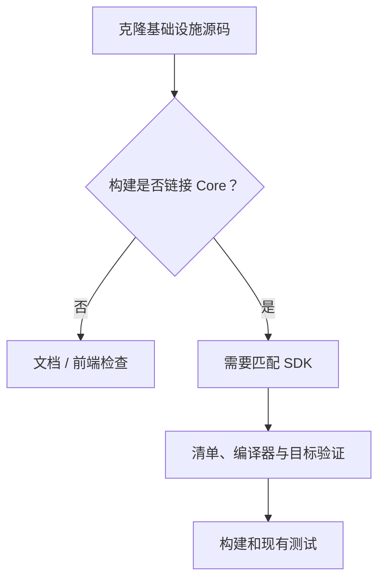

# 开发 {#development}

文档和前端可以独立开发。CLI/服务端构建除基础设施源码外，还需要兼容且已授权的 Core SDK。

| 仓库 | 现有检查 |
|---|---|
| 文档 | `node contracts/validate.mjs`、`npm run build` |
| CLI | SDK 配置后运行 `cargo test --locked -p respire` |
| 基础设施 crate | SDK 配置后运行各自现有 Cargo 测试 |
| 服务端 | `cargo test --locked -p respire_service`；数据库集成检查需要 PostgreSQL |
| 客户端 UI | `client/tree-ui` 中现有测试/构建 |
| 桌面端 | 已准备的兼容 CLI sidecar、运行时资源和平台依赖 |

## SDK 配置 {#sdk-setup}

| 步骤 | 要求 |
|---|---|
| 工具链 | 使用仓库固定的 Rust 工具链 |
| 锁定 | 匹配 `sdk/core-sdk.lock.json` 的清单 SHA-256 |
| 本地 SDK | 将 `RSRS_CORE_SDK_DIR` 设置为完整 SDK 目录 |
| 下载辅助程序 | `node scripts/fetch-core-sdk.mjs <target-triple> [output-directory]`；需要配置下载 URL 或提供完整本地 SDK |
| 构建验证 | 编译器发布版/提交、ABI、目标、panic 模式、CRT 和文件哈希必须精确匹配 |
| 测试夹具提供方 | 仅为现有夹具测试在宿主设置 `RSRS_CORE_TEST_MODE=1`；SDK 显式传递 `test_mode: true`，Core 从不读取该变量 |
| 分发 | 准备运行时库和第三方声明，不只是可执行文件 |

测试数据应放在独立数据目录。SDK 测试提供方不是生产模型回退方案。

CLI 构建请选择七种 [CLI 平台目标](getting-started.md#cli-platforms)之一。Linux GNU 和 musl 目标需要对应 SDK/运行时产物；不要用 GNU SDK 替代 musl 构建所需 SDK，反之亦然。`RSRS_LIBC` 选择 npm 启动器安装的二进制文件，不决定 Rust 编译目标。定义了目标并不代表二进制已发布或平台验证已完成。

| CLI 中的基础设施源码路径 | 职责 |
|---|---|
| `crates/protocol` | 共享数据类型 |
| `crates/crypto` | 密钥和记录加密 |
| `crates/storage` | 本地存储和同步支持 |
| `crates/app` | 应用编排 |
| `crates/core-sdk` | 安全 Core 适配器 |
| `cli` | 产品可执行文件和接口 |

运行与变更相适应的现有检查。保留错误原因和许可证声明；不要在 Rust 中新增 `.unwrap()` / `.expect()`。

[Windows 打包](windows-packaging.md)
