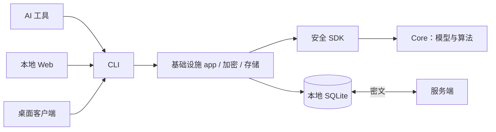

# Respire · rsrs {#respire-·-rsrs}

面向 AI 工具的本地优先记忆：在设备上维护工作记忆库，在本地检索，并跨设备同步加密记录。Respire 的唯一 CLI 命令是 **rsrs**，仓库组织为 **risense-ai**。

| 组件 | 职责 |
|---|---|
| CLI | 命令、授权、注入、JSON 输出与本地 runtime |
| Core | 模型执行、检索、排序、判重与上下文选择 |
| 基础设施 crates | 协议、密码学、持久化、同步与安全 SDK 适配 |
| 服务端 | 身份认证与各用户的密文存储 |
| Web / 桌面 | 使用 CLI 操作的同一套树形界面 |
| 官网 | 产品介绍，与记忆客户端分离 |

[开始使用](getting-started.md) · [了解架构](architecture.md) · [构建前提](development.md)
