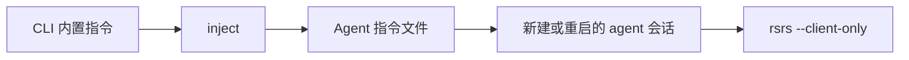

# Agent 集成 {#agent-integration}

`rsrs inject` 将 CLI 内置指令安装到受支持的 agent 配置文件。权威指令文本在 CLI 仓库中维护，不复制到本文档站点。

```sh
rsrs inject --targets
rsrs inject --id codex
rsrs inject --remove --id codex
```

运行 `inject --targets` 查看当前机器解析出的路径与检测状态。预设路径只是约定；使用自定义配置的 agent 可能需要单独的指令引用。

| 集成模式 | 行为 |
| --- | --- |
| 受管理块 | 只替换 Respire 标记之间的块 |
| 引用 | 写入指令文件，并更新受支持配置中的引用 |
| 整文件目标 | 将指令文本用作目标文件内容 |



| 检查项 | 操作 |
| --- | --- |
| 缺少目标 | 检查 `inject --targets` 与 agent 的真实配置路径 |
| 多个配置文件 | 检查 agent 加载哪个文件及指令列表 |
| 已有长期运行会话 | 更改指令后重启或新建会话 |
| 指令源已更改 | 重建或更新 CLI，然后重新运行 `inject` |
| Runtime 连接失败 | 检查本地 runtime 与认证；不要静默切换执行模式 |

受管理块使用 `<!-- respire:begin -->` 与 `<!-- respire:end -->`。保留块外无关指令。安装整文件目标前先审阅内容。

参见 [CLI](cli.md)、[CLI JSON](cli-api.md)、[插件](plugin-dev.md)与现成的 [AI 工具插件](plugins/index.md)。
