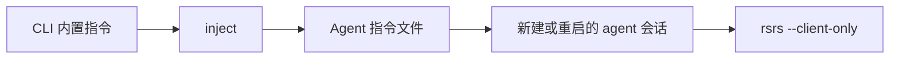

# Agent 集成 {#agent-integration}

`rsrs inject` 将 CLI 内置指令安装到受支持的 agent 配置文件。权威指令文本在 CLI 仓库中维护，不复制到本文档站点。

```sh
rsrs inject --targets
rsrs inject --id codex
rsrs inject --remove --id codex
```

运行 `inject --targets` 查看当前机器解析出的路径与检测状态。预设路径只是约定；使用自定义配置的 agent 可能需要单独的指令引用。

| 集成模式 | 行为 |
| --- | --- |
| 受管理块 | 只替换 Respire 标记之间的块 |
| 引用 | 写入指令文件，并更新受支持配置中的引用 |
| 整文件目标 | 用指令文本覆盖目标文件内容 |



| 检查项 | 操作 |
| --- | --- |
| 缺少目标 | 检查 `inject --targets` 与 agent 的真实配置路径 |
| 多个配置文件 | 检查 agent 加载哪个文件及指令列表 |
| 已有长期运行会话 | 更改指令后重启或新建会话 |
| 指令源已更改 | 重建或更新 CLI，然后重新运行 `inject` |
| Runtime 连接失败 | 检查本地 runtime 与认证；不要静默切换执行模式 |

受管理块使用 `<!-- respire:begin -->` 与 `<!-- respire:end -->`。保留块外无关指令。DSH 的整文件目标是 `~/.dsh/AGENTS.md`：注入会覆盖原有内容，并在写入前移除该路径上的符号链接。安装前请检查并备份目标。

## 通用包的首次注入 {#first-run-inject}

[respire-general](plugins/general.md) 没有安装脚本，也没有宿主 hooks。它在宿主启动 MCP server 时做首次注入检查：

```sh
node scripts/setup-inject.mjs --target auto
node scripts/setup-inject.mjs --target auto --check
```

脚本读取 `rsrs inject --targets --json`，只对 `absent` 或 `stale` 的目标执行注入；`current` 直接跳过，重复启动不会反复改写文件。注入成功后，结果记录到插件数据目录下的 `inject-state.json`。设 `auto_inject: false` 可关闭 MCP 启动时的检查，或用 `inject_target` 固定目标。mcode 没有 `rsrs inject` target，通用包会跳过；那里用 [MiniMax Code hooks 包](plugins/minimax-code.md)。

参见 [CLI](cli.md)、[CLI JSON](cli-api.md)、[插件](plugin-dev.md)与现成的 [AI 工具插件](plugins/index.md)。
