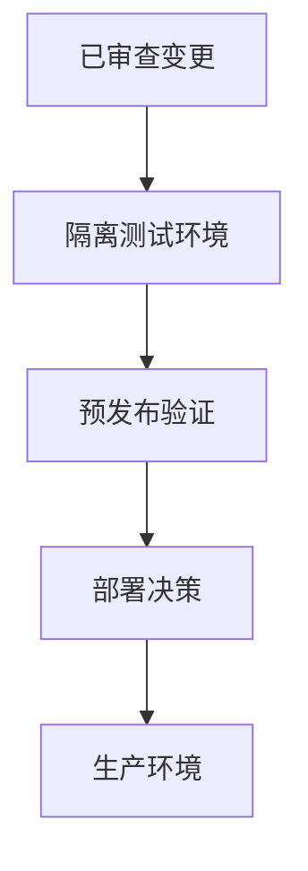

# 环境隔离 {#environment-separation}

部署环境必须使用独立数据库状态、凭据及显式选择的应用版本。本页描述隔离模型，不是内部主机目录，也不代表当前生产状态。

| Respire 目标 | 分配的 URL |
|---|---|
| 网站 | `https://rsrs.rs` |
| 用户控制台 | `https://dash.rsrs.rs` |
| 管理控制台 | `https://admin.rsrs.rs` |
| API | `https://api.rsrs.rs` |

这些域名与旧产品分开配置。本地 API 开发使用 `http://127.0.0.1:8787`；本地身份/运行时状态位于 `~/.rsrs`，运行时端口为 `15169`。启动会迁移先前本地账户，同时保留其原目录。

| 环境 | 数据 | 用途 |
| --- | --- | --- |
| 开发 | 合成或隔离数据 | 迭代与集成 |
| 预发布 | 经批准的隔离副本 | 升级与恢复演练 |
| 生产 | 真实业务数据 | 显式受控部署 |

| 资源 | 隔离要求 |
| --- | --- |
| Postgres | 独立数据库或数据卷和凭据 |
| 秘密 | 限定于预期环境 |
| API 与网站 | 显式路由至各自服务 |
| 镜像 | 选择不可变或明确标记版本的产物 |
| 备份 | 独立存储；在远离真实业务数据的环境测试恢复 |

发布 Git 分支与部署服务是不同操作。推断部署行为前，应检查实际仓库工作流触发条件。

部署前提见[自托管](server-deployment.md)。
