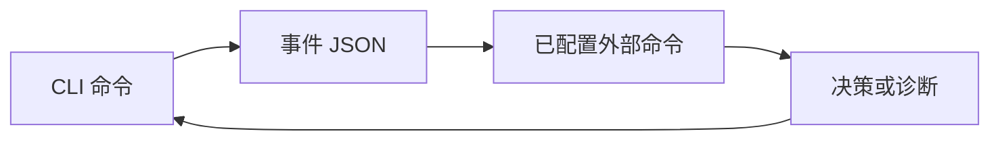

# 插件 {#plugins}

钩子插件是由 CLI 启动的命令。它从标准输入接收 JSON 事件，返回退出状态；前置钩子还可返回可选决策。



在 `<data directory>/plugins.json` 中配置钩子：

```json
{
  "hooks": {
    "pre-remember": [
      {"cmd":"python3 sensitive-scan.py","timeout_ms":3000,"on_error":"block"}
    ]
  }
}
```

| 字段 | 契约 |
| --- | --- |
| `cmd` | 必需命令；Windows 使用 `cmd.exe`，Unix 使用 `sh -c` |
| `timeout_ms` | 默认 5000 毫秒 |
| `on_error` | `block`、`warn` 或 `skip`；前置和后置钩子的默认值不同 |

| 事件 | 载荷摘要 | 能否否决？ |
| --- | --- | --- |
| `pre-remember` | 标题、分类元数据和有界内容预览 | 可以 |
| `post-remember` | 标识符、标题和重要性 | 不可以 |
| `post-recall` | 查询、项目及命中标识符 / 最终分数 | 不可以 |
| `post-forget` | 标识符 | 不可以 |
| `post-sync` | 拉取和推送计数 | 不可以 |

信封为 `{"event":"...","ts":"...","data":{}}`。子进程接收仅包含基础进程变量及 `RSRS_HOOK_EVENT` 的受限环境，不继承账户配置和凭据。

前置钩子的最后一行标准输出可以是：

```json
{"verdict":"block","reason":"review required"}
```

即使失败处理为 `skip`，显式 block 判定仍具有否决效力。后置钩子的标准输出不构成写入决策。应将事件载荷视为敏感数据：预览和查询可能含私密文本。

```sh
rsrs plugin list
rsrs plugin test pre-remember --payload '{"content_head":"example","title":"test"}'
```

`plugin test` 会实际运行配置的命令。钩子应及时退出，在适当情况下保持幂等，并避免输出秘密。超时不能保证终止外部子进程。插件不应打开内部数据库，也不应从钩子中递归调用 CLI。

参阅[集成方式](plugin-ecosystem.md)和 [CLI JSON](cli-api.md)。
