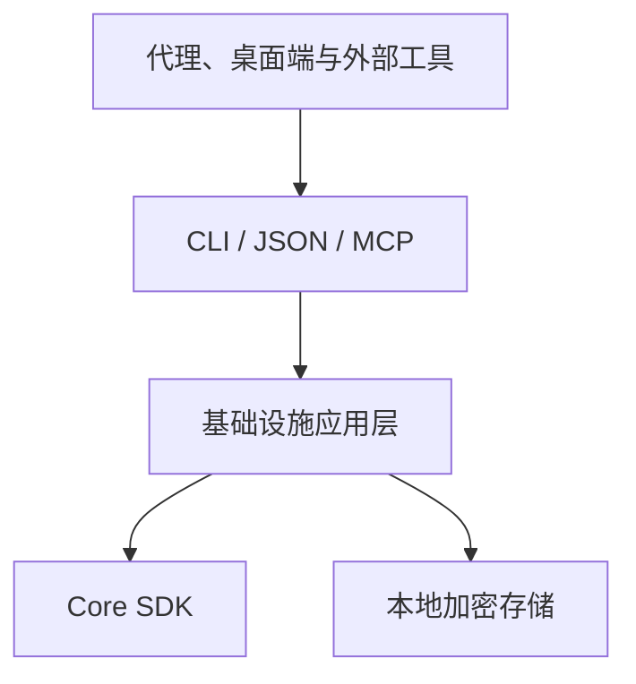

# 集成方式 {#integration-options}

使用受支持的 CLI 契约为 Respire 增加工作流，不依赖内部数据库结构或检索内部实现。

| 集成 | 接口 | 典型用途 |
| --- | --- | --- |
| 外部工具 | CLI `--json` | 报告、导出和可视化 |
| 钩子 | `plugins.json` 事件命令 | 写入前检查和操作后通知 |
| 代理指令 | `rsrs inject` | 工作前召回、工作后保存 |
| MCP | 标准 I/O 上的 `rsrs mcp` | 为兼容客户端提供受支持的记忆工具 |
| Agent Plugins 包 | `plugin.json` + `mcp.json` | 给没有专用适配的宿主提供 skill 与 MCP 工具 |
| 桌面端 | Client 2 使用本机 Runtime RPC 和受限宿主操作 | 提供受支持的 Runtime 与 CLI 操作界面 |

[respire-general](plugins/general.md) 是可移植的 Agent Plugins 1.0 包：一个 Agent Skill 加一个 `rsrs mcp` 的 `mcp.json` 入口，不带任何宿主 hooks。首次启动 MCP 时会查 `rsrs inject --targets`，只在检测到的目标是 `absent` 或 `stale` 时写入宿主指令文件；`current` 直接跳过。Agent Plugins 没有安装后脚本，所以不存在安装时注入。mcode 没有 `rsrs inject` target，通用包不会在那里自动注入。已有专用适配的宿主应优先用专用插件，让召回与落库由 hooks 执行。

| 规则 | 原因 |
| --- | --- |
| 解析机器输出 | 避免依赖翻译后的显示文本 |
| 保持账户秘密私密 | 钩子和外部工具只需要允许的输入 |
| 不读取内部数据库文件 | 存储格式不是集成 API |
| 显式表达副作用 | 导出、导入和插件执行产生不同影响 |
| 使用匹配 SDK 产物 | 匹配目标、工具链、ABI 和清单哈希 |

此列表描述已有接口类型，不承诺插件市场或任意进程内扩展。受支持工具集以各命令帮助为准。

参阅[插件](plugin-dev.md)、[代理集成](injection.md)、现成的 [AI 工具插件](plugins/index.md)、[CLI](cli.md)和 [CLI JSON](cli-api.md)。
