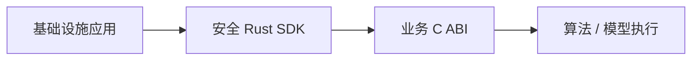

# Core {#core}

Core 是通过业务 C ABI 和安全 Rust SDK 分发的 Rust 引擎。

| Core | 基础设施 |
|---|---|
| 分块和特征解释 | 模型下载/校验和/进度及模型字节加载 |
| 语义检索和排序 | 账户密钥和加密 |
| 重排和去重 | SQLite 和同步 |
| 树/上下文建议 | HTTP 和授权修改 |
| BGE / reranker / ONNX 执行 | 文件、目录、数据库持久化、命令和 UI |

输入为已授权业务材料和不透明特征；输出为最终结果或建议。不提供公开的向量、余弦或中间排名 API。

Core 是只在内存中工作的计算引擎。它从宿主接收模型字节、已授权记录、不透明索引数据和显式执行设置。它不打开文件或数据库，不解析目录，不读取环境变量，也不选择存储名称。传入路径让 Core 自行打开文件违反此边界。不透明索引的序列化由 Core 负责；读取或持久化这些字节属于基础设施宿主。

宿主不解释不透明索引格式，也不重新实现分块、排序、去重、树策略或请求规划。这些私有算法和数据结构留在二进制 Core 内。不透明输出并不承诺加密或抵抗逆向工程。

| 集成规则 | 要求 |
|---|---|
| 分发 | 二进制 SDK；通过 C ABI 使用 |
| 所有权 | Core 拥有返回缓冲区；SDK 使用 RAII |
| 固定版本 | 清单哈希、精确编译器及匹配目标/CRT |
| 兼容性 | 保留旧版加密特征和存储格式 |
| 许可 | Core SDK 授权独立于基础设施源码许可 |

宿主 CLI 推理设置默认为 `~/.rsrs/inference.json`，模型默认为 `~/.rsrs/models/`。启动不会迁移旧库。宿主 CLI 提供显式迁移，保留原用户凭据和旧库。仍可显式覆盖数据/模型目录。公开 CLI 的加密迁移使用带版本的 `rsrs:*` 标签；密钥不会进入 Core。

[契约](../contracts.md) · [开发](../development.md)
