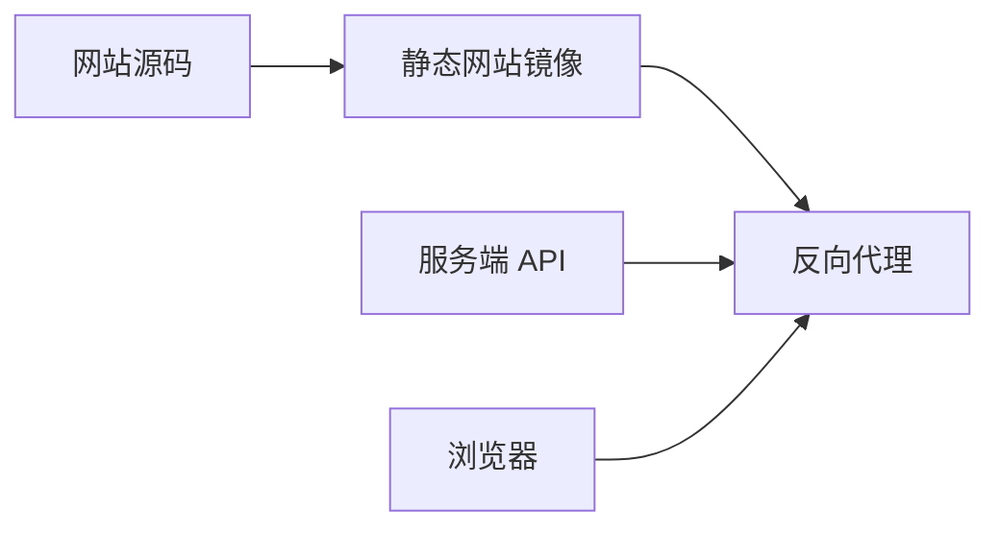

# 网站 {#website}

网站展示产品，不是本地记忆客户端。

| 分配的域名 | 用途 |
|---|---|
| `https://rsrs.rs` | 产品主站 |
| `https://dash.rsrs.rs` | 用户控制台 |
| `https://admin.rsrs.rs` | 管理控制台 |
| `https://api.rsrs.rs` | API 和同步 |

| 区域 | 职责 |
|---|---|
| 产品页面 | 网站仓库；英文和中文内容 |
| 账户页面 | 与服务器集成的 Web 前端 |
| 认证/同步 | 服务端 API |
| 本地记忆操作 | CLI / 本地 Web / 桌面端 |

静态网站与 API 应分开部署。文档或源码更新不会自动更新运行中的网站或 API。

[服务端部署](../server-deployment.md) · [本地 Web](web.md)
