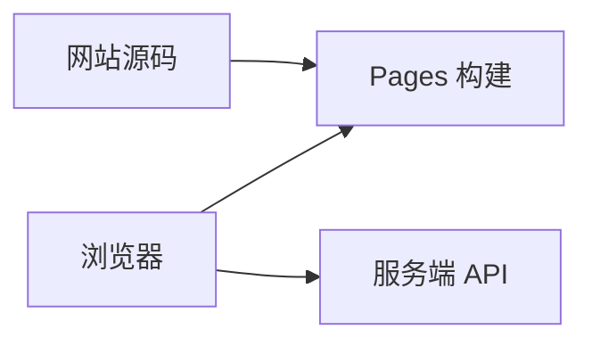

# 网站 {#website}

网站展示产品，不是本地记忆客户端。

| 分配的域名 | 用途 |
|---|---|
| `https://rsrs.rs` | 产品主站 |
| `https://dash.rsrs.rs` | 用户控制台 |
| `https://admin.rsrs.rs` | 管理控制台 |
| `https://api.rsrs.rs` | API 和同步 |

| 区域 | 职责 |
|---|---|
| 产品页面 | 网站仓库；英文和中文内容 |
| 账户页面 | 与服务器集成的 Web 前端 |
| 认证/同步 | 服务端 API |
| 本地记忆操作 | CLI / 桌面客户端 |

站点仓库描述了使用 Cloudflare Pages 部署网站和控制台的方案。该方案计划保留现有容器和流量，直到单独完成切换。站点分支更新可以触发 Pages 部署；API 单独部署。判断变更是否生效前，应检查实际部署配置和流量。

在隔离的测试 API、数据库和邮件测试环境准备好之前，应禁用分支预览。将 `VITE_API_BASE_URL` 配置为该 API 的精确 HTTPS 源，并在 `RSRS_CORS_ALLOWED_ORIGINS` 中逐一允许精确的预览源。公开构建不得包含凭据，并应使用合成账户。完整预览和上线条件见 [Pages 部署契约](https://github.com/risense-ai/respire-site/blob/main/console/CLOUDFLARE-PAGES.md)。

[服务端部署](../server-deployment.md) · [控制台](web.md)
