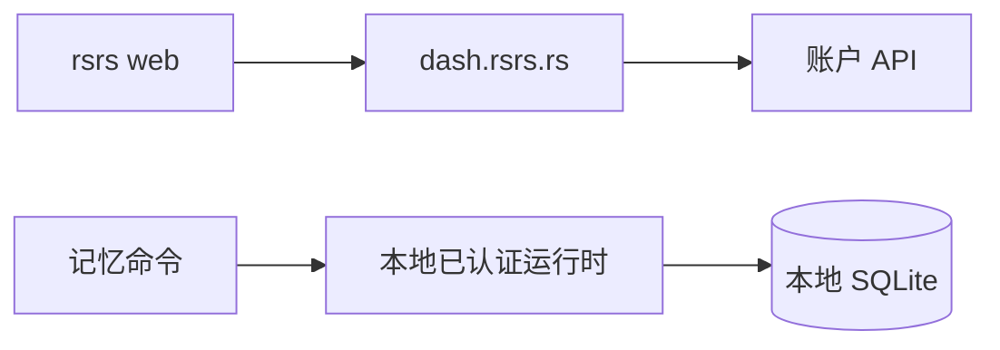

# 控制台 {#dashboard}

`rsrs web` 在浏览器中打开 `https://dash.rsrs.rs`。它不会启动本地网站或后台运行时。

| 项目 | 行为 |
|---|---|
| 控制台 | `https://dash.rsrs.rs` |
| 管理后台 | `https://admin.rsrs.rs` |
| 打开控制台 | `rsrs web` |
| 不打开浏览器，只输出目标地址 | `rsrs web --no-open` |
| 本地操作 | CLI 命令和已认证后台运行时 |

CLI 不包含嵌入式浏览器应用。后台运行时继续处理本地命令和排队的网络同步。

运行时使用端口 `15169` 和 `~/.rsrs`。其本地 HTTP 接口用于已认证 CLI 和工具通信，不是控制台。

[客户端](../client.md) · [CLI JSON](../cli-api.md)
