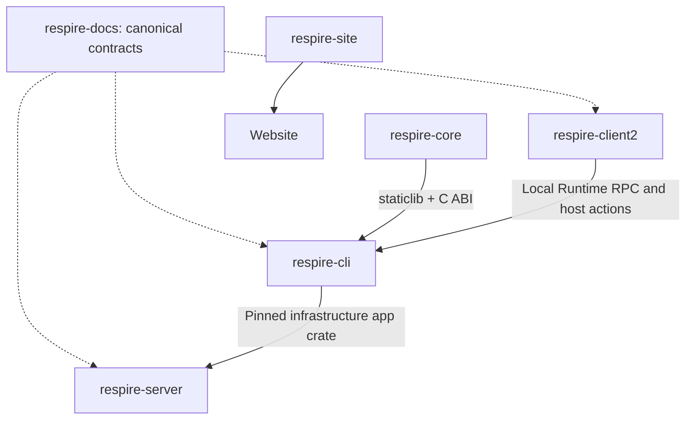

# 仓库 {#repositories}

| 仓库 | 用途 |
|---|---|
| [respire-cli](https://github.com/risense-ai/respire-cli) | CLI 以及协议、加密、存储、app 和安全 SDK crates |
| [respire-server](https://github.com/risense-ai/respire-server) | 身份认证、加密存储、HTTP API 与部署 |
| [respire-client2](https://github.com/risense-ai/respire-client2) | Go/Wails 桌面客户端、内嵌界面和本机 Runtime 管理 |
| [respire-docs](https://github.com/risense-ai/respire-docs) | 文档与权威契约 |
| [respire-site](https://github.com/risense-ai/respire-site) | 营销官网源码 |
| [respire-releases](https://github.com/risense-ai/respire-releases) | 发布信息与匹配的二进制产物 |
| [respire-core](https://github.com/risense-ai/respire-core) | 模型执行与记忆操作；二进制 SDK |

## AI 工具插件 {#ai-tool-plugins}

十个宿主插件将 Respire 接入 AI 工具。安装和使用步骤见[插件指南](/zh/plugins/)。

| 仓库 | 宿主 |
|---|---|
| [respire-zcode](https://github.com/risense-ai/respire-zcode) | ZCode |
| [respire-kimi](https://github.com/risense-ai/respire-kimi) | Kimi Code |
| [respire-dimcode](https://github.com/risense-ai/respire-dimcode) | Dim |
| [respire-qoder](https://github.com/risense-ai/respire-qoder) | Qoder |
| [respire-workbuddy](https://github.com/risense-ai/respire-workbuddy) | WorkBuddy |
| [respire-hermes](https://github.com/risense-ai/respire-hermes) | Hermes Agent |
| [respire-codex](https://github.com/risense-ai/respire-codex) | Codex |
| [respire-pi](https://github.com/risense-ai/respire-pi) | Pi |
| [respire-dsh](https://github.com/risense-ai/respire-dsh) | DSH |
| [respire-magpie](https://github.com/risense-ai/respire-magpie) | Magpie |

CLI/server 不检出 Core 源码，也不使用 Core submodule。CLI 固定 SDK manifest；服务端固定基础设施 app crate 的 revision，并使用相同的 SDK 边界。

| 变更 | 需协调的内容 |
|---|---|
| Core ABI / SDK | 权威契约、已验证的 SDK manifest 与消费端锁定版本 |
| 基础设施 app | CLI 源码 revision 与服务端依赖 |
| CLI 输出 | CLI 契约与桌面消费端 |
| 桌面 Runtime | CLI 发布元数据、平台目标与运行时资源 |
