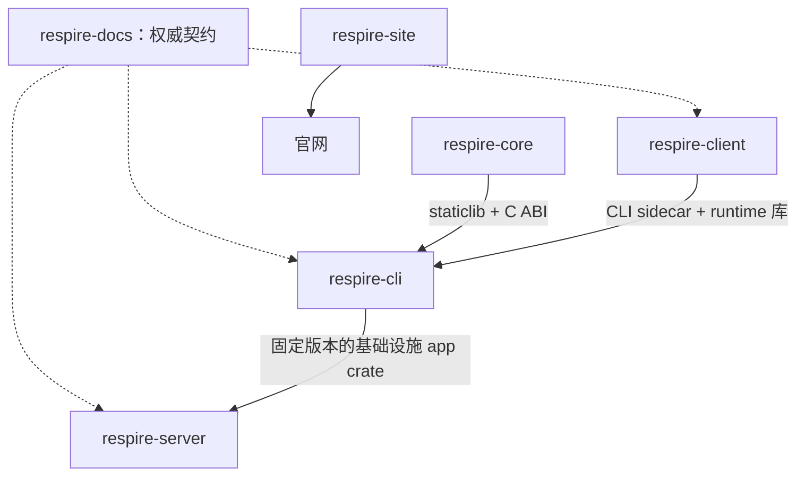

# 仓库 {#repositories}

| 仓库 | 用途 |
|---|---|
| [respire-cli](https://github.com/risense-ai/respire-cli) | CLI 以及协议、加密、存储、app 和安全 SDK crates |
| [respire-server](https://github.com/risense-ai/respire-server) | 身份认证、加密存储、HTTP API 与部署 |
| [respire-client](https://github.com/risense-ai/respire-client) | 树形 UI、Tauri 桌面外壳与 CLI sidecars |
| [respire-docs](https://github.com/risense-ai/respire-docs) | 文档与权威契约 |
| [respire-site](https://github.com/risense-ai/respire-site) | 营销官网源码 |
| [respire-releases](https://github.com/risense-ai/respire-releases) | 发布信息与匹配的二进制产物 |
| [respire-core](https://github.com/risense-ai/respire-core) | 模型执行与记忆操作；二进制 SDK |

CLI/server 不检出 Core 源码，也不使用 Core submodule。CLI 固定 SDK manifest；服务端固定基础设施 app crate 的 revision，并使用相同的 SDK 边界。

| 变更 | 需协调的内容 |
|---|---|
| Core ABI / SDK | 权威契约、已验证的 SDK manifest 与消费端锁定版本 |
| 基础设施 app | CLI 源码 revision 与服务端依赖 |
| CLI 输出 | CLI 契约与 Web/桌面消费端 |
| Sidecar | CLI 产物 manifest、客户端兼容性与 runtime 资源 |
