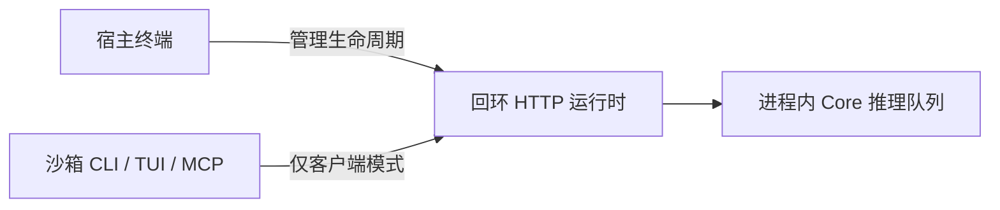

# 宿主运行时与沙箱客户端 {#host-runtime-and-sandbox-clients}



| 环境 | 行为 |
| --- | --- |
| 宿主 | 启动、停止、更新和恢复运行时 |
| 沙箱 | 连接宿主回环运行时；保留已有的兼容令牌 |
| 受限 Windows 令牌 | 自动选择仅客户端模式 |
| 其他沙箱 | 由集成显式选择仅客户端模式 |

```sh
# Hosted dashboard (does not start the local runtime)
rsrs web
# Host lifecycle diagnostics
rsrs --runtime-internal
rsrs --runtime-internal --stop
# Sandbox
rsrs --client-only recall "query" --titles --json
```

仅客户端模式禁止改变生命周期、复制二进制文件、升级、CPU 恢复和 `--direct` 执行。MCP stdio 不会复制可执行文件。请求失败不会触发沙箱接管。空闲运行时会持续运行，直到宿主将其停止。

宿主的 `account <name>`、`account use <name>`、`space use <name>` 和 `config --data-dir <path>` 协调关闭服务、选择配置档案和重启。目标无效时保留原档案并重启其服务。仅客户端工具不能切换宿主档案。`--direct` 仍要求运行时已停止，不会自动接管。

| 设置 | 用途 |
| --- | --- |
| `RSRS_CLIENT_ONLY=1` | 宿主运行时客户端模式 |
| `RSRS_NO_AUTOSTART=1` | 用于兼容的同义设置 |
| `RSRS_RPC_PORT` | 覆盖默认端口 `15169` |

CLI / TUI / MCP stdio 连接 `127.0.0.1`。为兼容旧运行时，首次健康检查、RPC 和停止请求会附带已有的 `RSRS_RPC_TOKEN` 或运行时令牌文件。新的回环监听器不要求也不创建令牌。运行时目前拒绝非回环绑定地址，因此不支持跨机器访问运行时。非回环对端始终需要认证。服务检查真实对端地址，而非 Host 或转发标头。每个请求的 Host 必须是已绑定的回环主机和端口，或带绑定端口的 `localhost`；绑定 HTTP 端口 80 时，Host 可以省略 `:80`。GET 和 POST 都会检查 Origin。MCP 端点使用实际绑定地址。

不要将令牌放入提示词或报告。远程容器不会自动共享宿主的回环地址。

| 错误 | 含义 | 操作 |
| --- | --- | --- |
| `runtime_unavailable` | 运行时不可用 | 由宿主启动服务 |
| `runtime_unauthorized` | 认证被拒绝 | 宿主核实旧运行时已有的令牌与端点；不要绕过认证 |
| `runtime_transport` | 连接失败 | 宿主检查端点和网络 |

## 服务端部署 {#server-deployment}

| 服务 | 地址 |
| --- | --- |
| 主站 | `https://rsrs.rs` |
| 用户控制台 | `https://dash.rsrs.rs` |
| 管理后台 | `https://admin.rsrs.rs` |
| 默认 API | `https://api.rsrs.rs` |

可以通过服务器设置更改默认 API。Respire 使用 `~/.rsrs` 和端口 `15169`；启动时保留选定账户，不会导入旧档案。使用 TUI 的 **Migrate old version（迁移旧版本）** 或 `rsrs migrate` 显式选择源与目标账户。原目录保持完整。仍支持显式 `ONEMEMORY_*` 覆盖设置，数据库文件名和传输格式也保持兼容。

## 账户登录、切换与索引 {#account-login-switching-and-indexing}

`rsrs login`（或 `rsrs login --oauth`）通过托管控制台授权。`rsrs login --interactive` 允许选择 OAuth 或密码/TOTP。提供 `--pass` 会显式选择密码登录；`--interactive --oauth` 选择 OAuth。TUI 的 Accounts > Sign in 入口提供相同选择。认证后，CLI 在本地请求记忆超级密码，并在保存或选择档案前验证保险库。普通登录不接受 `--secret-key`，也不会重置已有保险库。旧版解密材料由显式迁移或恢复操作处理。

使用 `rsrs migrate --source ... --account ...` 完整迁移旧库后，选择该迁移账户并运行 `rsrs migrate --vault`。提供原登录密码、v2/v3 的旧版 `--super` 口令，以及尚未保存在会话中的 v3 `--secret-key`。此操作要求云端密钥封装与选定库匹配。本地迁移会解密所有保留记录（包括删除标记），并使用 `rsrs:*` 密钥标签写入重新加密的 `rsrs.db`。原始源数据库不变。云端发布保留原 URK、保险库因子版本、登录密码和 super Key；不会发放新恢复码，也不会静默升级保险库到 v4。使用相同登录密码和当前盐标签重新计算认证哈希。

发布要求选定 API 服务器支持 `/auth/salt`，且宿主/运行时账户已验证。如果确认信息丢失，请使用原凭据重复显式迁移；本地事务完成前会核实已提交且匹配的写入。为兼容而使用 `--new-super` 时，其值必须等于原 super Key。没有密钥环的无界面宿主通过 `RSRS_SUPER` 提供原 Key。普通登录不会执行迁移。

宿主停止前一个运行时，提交已验证会话和选定目录，启动目标运行时，并回读账户与路径。启动或验证失败时恢复原会话和完整客户端设置，再重启原运行时。TUI 仅在回读成功后显示成功。TUI 轮询连接已运行的服务，不会反复尝试接管；宿主子进程的诊断信息会被捕获并显示在界面中。

可用账户的索引无效时，运行时会准备缺失的 M3 资源，并在后台重建派生索引。重启后继续未完成工作。进度和下载错误显示在 TUI 中，无需确认重建。原记录、密文和同步状态保留。显式设置的模型路径无效或下载失败仍会报错，不会静默切换模型。

API 契约和部署顺序见[浏览器授权与 TOTP](browser-api-contract.md)。DEV 验收必须在发布前使用真实旧二进制文件和隔离数据，覆盖两种 Windows shell、模型缺失/重启行为及两种登录方式；未执行的检查不能算通过。

## 托管控制台与本地传输 {#hosted-dashboard-and-local-transport}

`rsrs web` 打开 `https://dash.rsrs.rs`。`rsrs web --no-open --json` 输出该 URL 而不打开浏览器。它不会启动、停止或绑定运行时。旧的 `web --host`、`--port`、`--status`、`--stop` 和 `--internal` 参数不再受支持。

隐藏入口 `--runtime-internal` 专用于宿主生命周期和自动诊断。需要运行时的命令会在允许时自动启动运行时；受限客户端只连接。本地 `/api/health`、`/api/rpc`、`/api/runtime/stop`、`/mcp` 和 `/sse` 接受无需令牌的真实回环对端。非回环对端不能豁免令牌检查，目前也不支持非回环监听。浏览器页面、静态资源、`/api/invoke` 和 `/api/task` 已移除。非回环认证入口接受标头中的令牌，绝不接受控制台 URL 中的令牌。

## 升级旧运行时 {#upgrading-an-older-runtime}

宿主命令 `rsrs --runtime-internal --stop` 支持仍要求回环令牌的运行时，包括 1.0.9。健康检查、RPC 和停止操作在首次请求中附带已有的 `RSRS_RPC_TOKEN` 或运行时令牌文件。失败请求不会重放。客户端不会创建或替换凭据。当前回环运行时忽略兼容标头，无令牌文件也能运行。健康检查和普通 RPC 使用相同兼容规则，因此宿主升级可以先正常停止旧运行时，再启动新可执行文件。

生命周期命令应从宿主终端运行；仅客户端模式不允许关闭服务。旧令牌缺失或被拒绝时，需要旧运行时已有的认证材料，不能绕过认证或终止未经核实的进程。本地运行时客户端禁用 HTTP 重定向。
