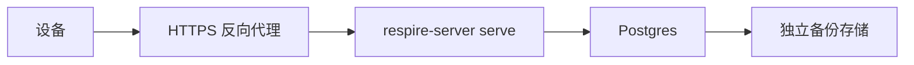

# 自托管 {#self-hosting}

使用 Postgres 和 HTTPS 入口部署 API。服务器保存加密记录；账户解密密钥留在客户端。



## Compose {#compose}

在服务端仓库中运行：

```sh
cp .env.example .env
# Fill in deployment secrets and select an available image.
docker compose pull
docker compose up -d
curl -fsS http://127.0.0.1:8787/ready
```

| 配置 | 用途 |
| --- | --- |
| `POSTGRES_PASSWORD` | 必需数据库秘密 |
| `RSRS_SERVER_IMAGE` | 显式镜像标签 |
| `RSRS_HOST_BIND`、`RSRS_HOST_PORT` | 宿主监听器；Compose 默认使用回环地址和端口 8787 |
| `RSRS_ADMIN_TOKEN` | 可选管理令牌 |

提供的 Compose 配置使用 Postgres 16，数据库/用户为 `respire`，并使用独立的 `respire-pg` 数据卷。它不复用旧产品数据库卷。已有 `ONEMEMORY_*` 选项名称仍是显式兼容接口；密码学派生与同步格式不变。应用升级时不要删除数据卷。

## 构建前提 {#build-prerequisites}

| 要求 | 检查 |
| --- | --- |
| Rust 工具链 | 匹配仓库固定工具链和 SDK 清单 |
| 二进制 Core SDK | 获取匹配构建目标的产物；验证锁文件和哈希 |
| 运行时库与声明 | 准备 SDK 要求的运行时文件和许可证 |
| 数据库 | 设置 `DATABASE_URL`；云服务没有 SQLite 回退方案 |

```sh
node scripts/fetch-core-sdk.mjs x86_64-unknown-linux-gnu
cargo build --release --locked -p respire_service --bin respire-server
docker build -f service/Dockerfile -t respire-server:local .
```

无人值守构建应配置 SDK 下载 URL，或提供与锁文件匹配的完整本地 SDK。

## 备份与升级 {#backup-and-upgrade}

| 步骤 | 流程 |
| --- | --- |
| 备份 | 使用 Postgres `pg_dump -Fc`；保护凭据和转储文件 |
| 验证 | 检查转储，在隔离数据库中演练恢复 |
| 升级 | 先备份、停止旧写入方，再部署选定镜像 |
| 就绪检查 | 验证 `/ready`、预期模式和同步行为 |
| 恢复 | 恢复前停止写入；谨慎处理同步 epoch 变化 |

对于提供的 Compose 数据库：

```sh
docker compose exec -T db pg_dump -U respire -d respire -Fc > respire.dump
```

旧转储不包含创建后的写入。旧应用不能向不受支持的新模式写入。恢复语义见[同步 v2](sync-v2-rollout.md)。

CLI 浏览器授权通过新增设备授权表，将云数据库模式升级到版本 5。现有账户、保险库和记忆行保留。模式 4 的二进制文件拒绝模式 5：上线前应在隔离数据库中演练升级前备份恢复，不要假设回退镜像可以撤销模式迁移。恢复数据前停止写入，并检查备份时间和同步状态。
