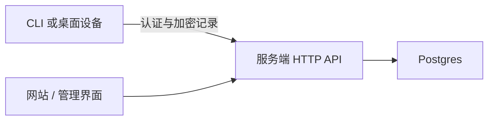

# 服务端 {#server}

`respire-server serve` 提供由 Postgres 支撑的认证和加密记录同步。在正常云服务运行中，它不会解密用户记录或加载检索模型。

## 配置 {#configuration}

| 变量 | 用途 |
| --- | --- |
| `DATABASE_URL` | 必需的 Postgres 连接字符串 |
| `RSRS_ADMIN_TOKEN` | 可选管理入口 |
| `RSRS_DB_WORKERS` | 数据库工作池大小，范围为 1 至 16 |

凭据应放在部署的秘密配置中。不要提交真实连接字符串或管理令牌。

## HTTP 接口 {#http-interface}

| 端点族 | 用途 |
| --- | --- |
| `GET /health` | 进程存活检查 |
| `GET /ready` | 数据库和模式就绪检查；依赖不可用时返回 503 |
| `/register`、`/login`、`/login/totp` | 账户认证 |
| `/oauth/device/code`、`/oauth/token` | 控制台登录/TOTP 后的一次性 CLI 浏览器授权 |
| `/forgot`、`/reset` | 登录密码恢复 |
| `/api/self/*` | 账户设置、会话、密钥封装和双因素认证 |
| `/push`、`/push/batch`、`/pull`、`/forget` | 旧版加密同步 |
| `/sync/capabilities` | 能力协商 |
| `/v2/*` | 基于操作的同步与冲突决策 |
| `/admin/*` | 已授权管理 |

精确方法和载荷应以仓库的 `contracts/openapi.yaml` 及路由实现为准。OpenAPI 文件覆盖的路由可能少于服务端；不要从此概览推断未记载的管理操作。

| 管理员角色 | 范围 |
| --- | --- |
| Owner | 管理员管理及管理访问 |
| Admin | 允许的账户和加密记录管理 |
| Viewer | 只读管理访问 |

## 实现路径 {#implementation-map}

| 路径 | 职责 |
| --- | --- |
| `service/src/main.rs` | 进程入口 |
| `service/src/http/` | 路由、认证和请求边界 |
| `service/src/store/` | Postgres 存储、迁移和同步账本 |
| `service/src/totp.rs` | 双因素认证 |
| `admin-ui/` | 管理前端 |

服务端使用固定 CLI 修订版中的基础设施应用包。因此，即使普通云请求不执行本地模型推理，构建仍可能需要匹配的二进制 Core SDK。

参阅[部署](server-deployment.md)、[请求边界](server-request-boundaries.md)和[同步](sync-v2-rollout.md)。
