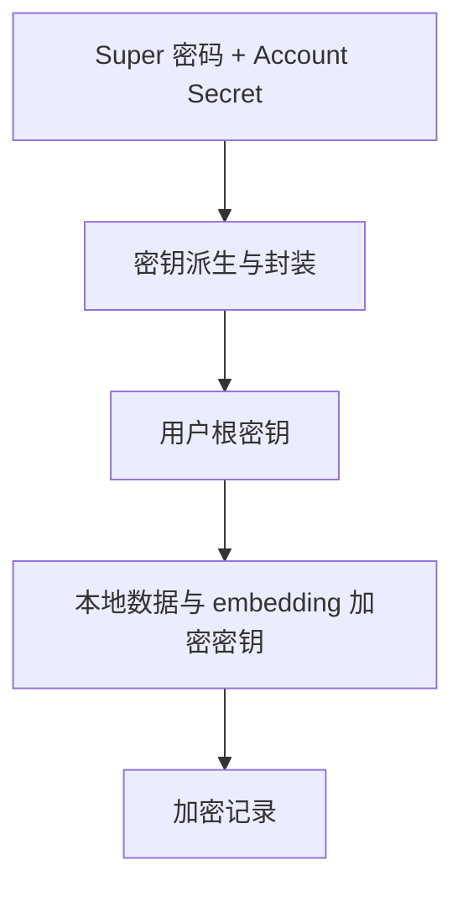

# 同步与密钥 {#synchronization-and-keys}

同步传输加密记录。解密、本地索引与检索在用户设备上完成；服务端不需要模型或账户解密密钥。

| 模式 | 行为 |
| --- | --- |
| 本地 | 未配置远程连接 |
| 自动 | Runtime 在支持的写入后调度同步 |
| 手动 | 显式运行 `rsrs sync` |

`RSRS_NO_AUTOSYNC` 覆盖账户的 `client.json` 设置。非零值禁用自动同步。显式 `sync` 等待本次同步尝试完成。

## 记录处理 {#record-handling}

| 机制 | 用途 |
| --- | --- |
| 脏记录 / outbox | 保留等待确认的本地编辑 |
| 有序服务端 cursor | 下载更改，不依赖设备时钟 |
| Tombstone | 同步删除意图 |
| 保留版本 | 保留冲突及历史，供审阅 |
| 本地特征产物 | 可重建的检索数据，与加密内容 revision 分离 |

冲突决策与服务端恢复见[同步 v2](sync-v2-rollout.md)。

## 密钥所有权 {#key-ownership}

| 变更 | 效果 |
| --- | --- |
| 登录密码 | 更改身份认证凭据 |
| 重置 super 密码 | 重新封装根密钥，不改写全部记录 |
| 新设备 | 需要身份认证与必要的密钥恢复材料 |
| 退出登录 | 遵循 `logout --help`；删除本地身份与撤销远程 session 分离 |

旧 v1 恢复使用原登录密码与 Account Secret，没有独立的 super 密码。上面的封装图描述有独立 super/恢复因素的账户；不要为 v1 恢复要求替代 super 密码。普通登录保留 vault 版本及加密读写格式。只有显式命名空间迁移才改写选中的副本，并保留原因素与来源。

服务端在 `POST /api/self/vault` 存储不透明 vault versions 1 至 4。首次上传恢复材料时发送 `If-None-Match: *`，仅创建不存在的 vault。若已有另一 vault，服务端返回 `412` 并保留它；客户端必须读取并验证，不可覆盖。无效字段、版本或不受支持的条件返回 `400`。未带条件的请求保留原 upsert 行为，不适合首次恢复初始化。

`POST /api/self/vault` 还接受可选的 `wrapped_urk_server` 与 `server_urk_nonce` 字段：同一 URK 在服务端 KMS 信封密钥下的第二层不透明封装。二者均为附加且可选——缺省时保留现有 vault 及已存的信封，`GET /api/self/vault` 会返回它们，未设置前为空。服务端仍只存储不透明字符串、不派生任何客户端密钥；持有信封密钥的宿主机无需 super 密码即可解包 URK，当设置 `RSRS_SERVER_KEK` 时 CLI 会这样做。

vault API 契约在两仓之间镜像：`respire-server/service/openapi.yaml` 携带请求字段，`respire-docs/contracts/openapi.yaml` 保留权威副本。可选字段属附加，因此两份副本保持兼容，无需 bump consumer pin。对应的服务端 schema 迁移（`0007_vault_server_envelope`，schema 版本 8）必须在客户端写入信封字段前应用，因为旧服务端会忽略未知 JSON 字段、仅存储不含信封的 vault。

迁移凭据、Account Secret 及 session 文件应保持私密。不要加入仓库，也不要通过普通插件 payload 发送。

## 备份 {#backup}

| 备份 | 包含的内容 | 恢复前提 |
| --- | --- | --- |
| `export` | 明文记录 | 保护导出文件 |
| `backup` | 本地 SQLite 数据库 | 保留匹配的密钥材料 |
| 密钥恢复材料 | 账户秘密或封装密钥访问材料 | 与数据库备份独立保存 |

替换活动数据库前，先停止对应 runtime 并遵循已安装版本的恢复流程。依赖备份前，先验证恢复副本。
