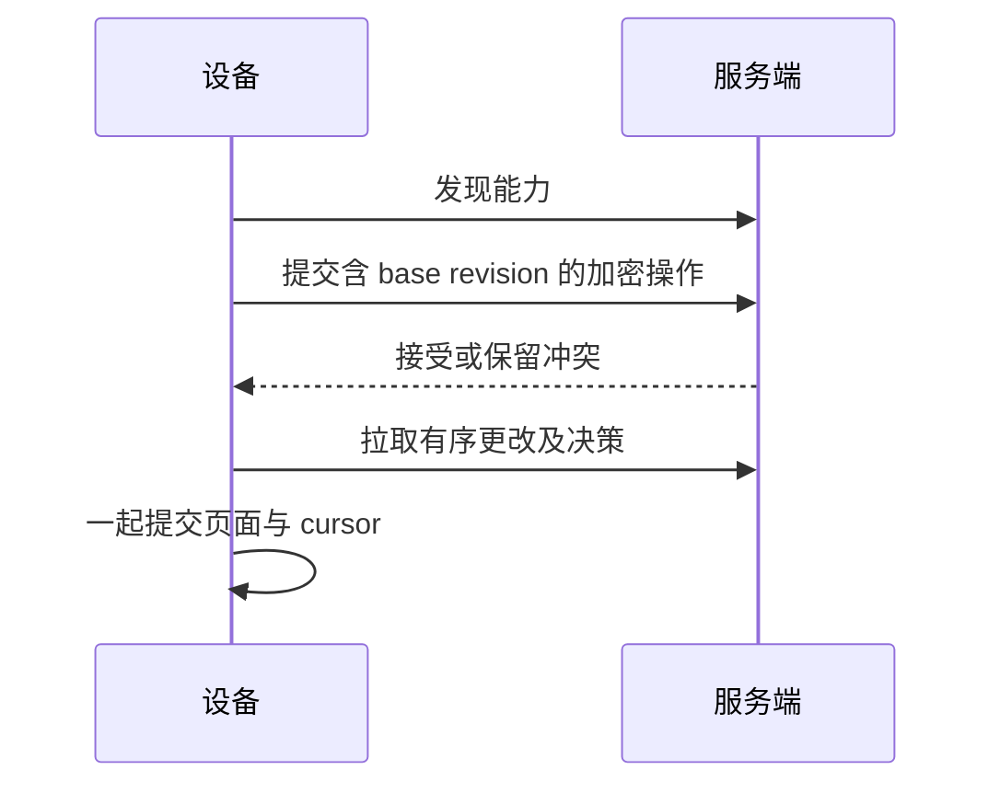

# 同步 v2 {#synchronization-v2}

服务端与各设备协商同步能力。旧路由保留为兼容接口；已协商 v2 的设备不能静默回退到 v1。



| 术语 | 含义 |
| --- | --- |
| `op_id` | 重试使用的稳定操作身份 |
| `base_rev` | 编辑时实际基于的 revision |
| Epoch | 服务端历史身份；在主动恢复轮换后变化 |
| Conflict | 为审阅保留的分歧编辑 |
| Resolution | 具有独立有序投递 cursor 的显式决策 |
| Index pending | 加密内容存在，但本地检索数据需要重建 |

## 审阅与解决 {#review-and-resolve}

```sh
rsrs sync-conflicts --refresh
rsrs sync-history --id <id>
rsrs sync-resolve --help
rsrs sync-restore --help
```

| 决策 | 结果 |
| --- | --- |
| 保留当前版本 | 保留当前 head；过期 head 检查保护期间发生的编辑 |
| 接受传入版本 | 接受选中的保留版本，包括其删除意图 |
| 合并 | 根据审阅后的内容创建新编辑 |
| 恢复历史 | 将保留版本作为新操作恢复 |

只有服务端接受并分发决策后，冲突才在各设备上解决。标题相同、时间戳更新或记录数相同，都不能证明两个 revision 等价。

## 升级与恢复 {#upgrade-and-recovery}

| 阶段 | 必须检查的内容 |
| --- | --- |
| 升级前 | 备份 Postgres，并在隔离副本中演练恢复 |
| 服务端升级 | 停止旧写入者；schema 迁移完成后才接收请求 |
| 就绪状态 | 验证 `/ready`、预期 schema 与兼容路由 |
| 客户端推广 | 分别升级各设备，观察协商能力 |
| 从备份恢复 | 停止写入，并主动轮换受影响账户的同步 epoch |
| 设备恢复 | 审阅 `sync-reset`，再在保留本地历史及待提交编辑的前提下同步 |

恢复旧 dump 会丢弃后续服务端写入。这是灾难恢复操作，不是普通应用回滚。不要让旧写入者运行于其不支持的新 schema。

`sync` 不要求加载 embedding 模型。使用 `reembed` 单独重建待处理的本地索引。清除当前内容不等于清除全部保留的同步版本。
