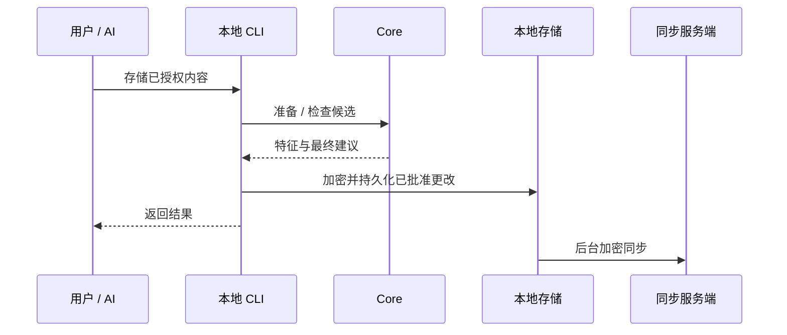

# 操作演练 {#walkthrough}

使用已安装的兼容版本。实验时应选择独立数据目录，避免使用工作记忆库。

| 步骤 | 命令 / 操作 |
|---|---|
| 检查安装 | `rsrs doctor` |
| 选择身份 | 注册/登录以同步，或使用 `keygen` 仅在本地使用 |
| 记录决策 | `rsrs remember "..." --type decision --title "..." --importance important` |
| 记录日记 | `rsrs remember "..." --importance trivial` |
| 查找记录 | `rsrs recall "..." --limit 3` |
| 检查结构 | `rsrs tree`，然后 `rsrs show <id>` |
| 主动同步 | 使用有效服务端身份执行 `rsrs sync` |
| 在另一设备恢复 | 按[同步与密钥](sync-and-keys.md)使用已有账户恢复材料 |

退出服务端登录与清除本地身份是两件事。删除身份信息前请阅读各命令的帮助。明文导出与加密数据库备份是不同的产物。

[CLI 参考](cli.md) · [客户端](client.md)
