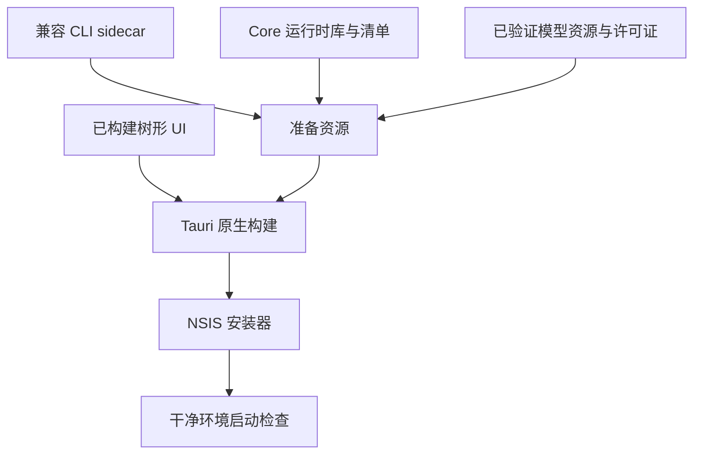

# Windows 打包 {#windows-packaging}

完整 Windows 桌面包需要的不只是可执行文件。

| 资源 | 要求 |
|---|---|
| CLI | 版本/目标必须匹配客户端兼容性契约 |
| Core 运行时 | 准备已验证运行时清单声明的每个文件 |
| 模型 | 验证仓库固定修订版/校验和；包含模型归属声明 |
| 声明 | 保留 SDK、原生库和模型许可证声明 |
| WebView2 | 视为独立平台运行时，不能替代模型/Core 资源 |
| CRT | 匹配 CLI/SDK 动态 CRT 配置 |

客户端准备脚本和 Tauri 配置定义实际目标路径。运行时库应在 sidecar 旁可访问；验证启动时不依赖开发机器全局缓存。

| 验证 | 检查 |
|---|---|
| 打包前 | Sidecar/运行时/模型哈希和目标 |
| 打包后 | 资源存在、版本和许可证 |
| 干净安装 | 应用启动且模型加载 |
| 离线行为 | 核实安装器包含的资源；不要假设每个安装器都完全离线 |

[客户端集成](CLIENT-GUIDE.md)
